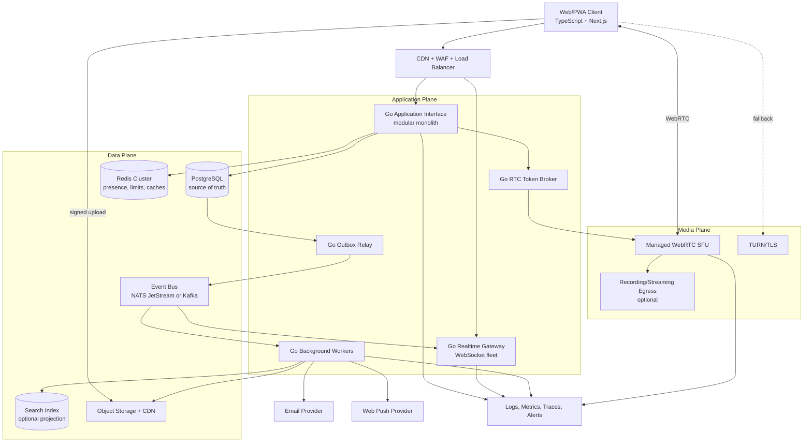
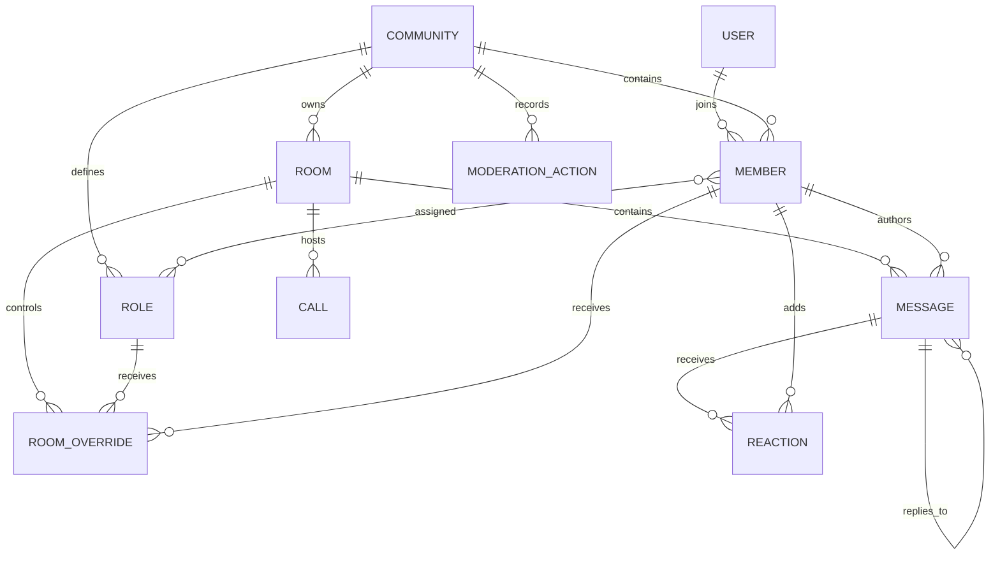
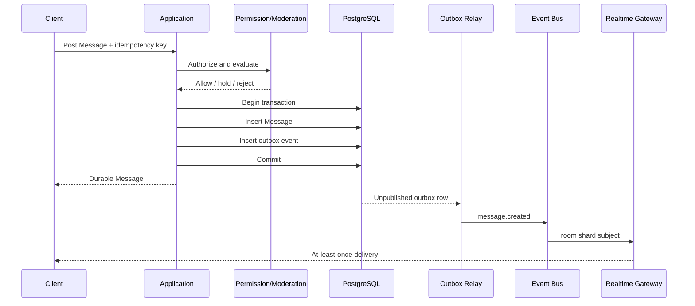
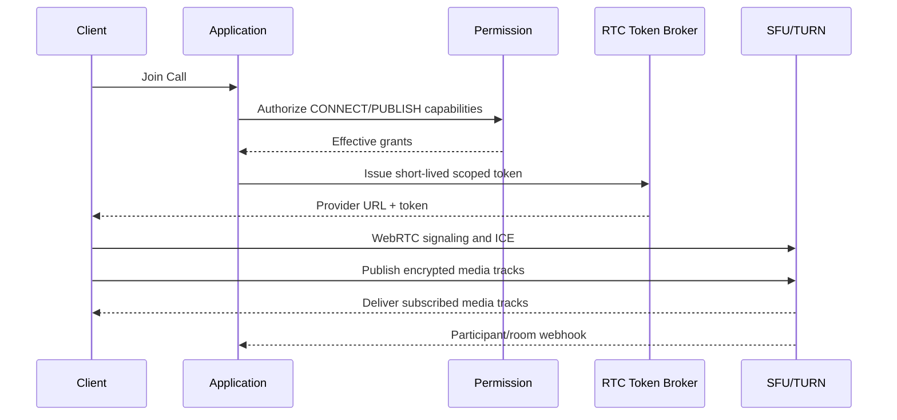

# Community Communications Platform — System Design

**Status:** Draft for PRD development
**Date:** 2026-10-15
**Initial use case:** Conferences and professional communities
**Scale target:** 1,000–100,000 registered users, with a designed scale-out path to 100,000 concurrent connections
**Language decision:** TypeScript for the web client; Go for backend, realtime, workers, and RTC control

## 1. Product description

We are building a low-friction, web-first community communications platform for conferences and professional groups. A person joins with a verified work email and a community-specific username, without installing an application or creating a password. Inside a Community, Members can create Rooms, exchange persistent Messages, organize discussions into Threads, react to content, see Presence, and join live audio/video Calls or moderated Stages.

Community owners can define custom Roles and Permissions, delegate administration, restrict individual Rooms, moderate content, and publish announcements. The first product experience is conference-oriented, but the model deliberately supports persistent communities after an event ends.

This is not a literal Discord clone. It prioritizes low entry friction, professional identity, conference discovery, safe delegation, predictable moderation, and browser-based participation.

### PRD-ready problem statement

Conference communication is usually fragmented across email, event apps, video links, and informal chat groups. Attendees face installation and account-creation friction, while organizers lack a single place for session discussion, announcements, networking, live participation, and moderation. The product gives every conference a configurable Community that attendees can enter with a verified work email, then use for persistent chat and live communication from any modern browser.

### Primary users

- **Member:** joins Communities, creates or joins permitted Rooms, sends Messages, and participates in Calls.
- **Community owner:** configures the Community, creates Roles, delegates management, and controls policy.
- **Moderator:** reviews reports and performs auditable Moderation Actions.
- **Speaker:** presents in a Stage or Call with temporary media-publishing permission.

### Core jobs to be done

- Join a conference Community in under one minute using a work email.
- Find relevant Rooms and people without learning a complex permission system.
- Hold durable, realtime conversations before, during, and after sessions.
- Create focused Rooms without requiring an organizer for every interaction.
- Join reliable browser-based audio/video sessions.
- Delegate moderation and Room management without giving away full ownership.
- Preserve announcements and important context when the event is busy.

## 2. Scope

### Initial product capabilities

- Passwordless email verification using a six-digit one-time code.
- Community-specific usernames and profiles.
- Public, private, and discoverable Rooms.
- Text Rooms, voice/video Rooms, and moderated Stages.
- Persistent Messages, Threads, edits, deletion, reactions, mentions, and attachments.
- Custom Roles, hierarchical role management, and Room Overrides.
- Presence, typing indicators, unread state, and notifications.
- Reporting, slow mode, timeouts, removal, bans, and an audit log.
- Live audio, video, and screen sharing through a managed SFU.
- Organizer announcements and conference schedule integration.

### Explicit non-goals for the first release

- Native desktop or mobile applications.
- User-built bots or a public plugin marketplace.
- Federation between independently operated platforms.
- Custom media codecs or an internally built SFU/TURN network.
- End-to-end encrypted persistent Messages.
- Algorithmic social feeds.
- Large public livestreaming comparable to a broadcast CDN.

## 3. Capacity assumptions

“100,000 users” is ambiguous, so this design separates registered, connected, and media-active users.

| Dimension | Baseline target | Scale-out target |
| --- | ---: | ---: |
| Registered Users | 100,000 | 1,000,000+ |
| Simultaneously connected clients | 20,000 | 100,000 |
| Peak Message writes | 2,000/second | 10,000/second |
| Realtime fan-out deliveries | 100,000/second | 1,000,000/second |
| Simultaneous RTC participants | 5,000 across Rooms | 25,000 across Rooms/regions |
| Largest interactive Call | 500 participants | Product/vendor validated |
| Largest Stage audience | 5,000 | Dedicated livestream path if exceeded |

These are planning assumptions, not performance claims. Load tests and the selected RTC provider's quotas must establish production limits. A single conference with 100,000 simultaneous attendees is a materially larger problem than a platform with 100,000 registered users and must use the scale-out topology from launch.

## 4. Architectural principles

1. **Web first:** ship a responsive Progressive Web App; installation remains optional.
2. **Durable writes before broadcast:** acknowledge a Message only after it and its outbox event commit.
3. **HTTP for state, WebSockets for change:** history and recovery come from durable interfaces; realtime delivery carries deltas.
4. **At-least-once delivery:** clients deduplicate by event ID and reconcile after reconnecting.
5. **No global ordering:** deterministic order exists within a Room; Communities and Rooms progress independently.
6. **Separate control and media planes:** application servers authorize Calls but never relay audio/video packets.
7. **Modular monolith first:** keep domain rules local while independently scaling WebSocket gateways, workers, and RTC.
8. **Authorization on every path:** HTTP, WebSocket subscriptions, attachment access, and RTC tokens use the same Permission module.
9. **Ephemeral state stays ephemeral:** Presence and typing indicators do not become source-of-truth database records.
10. **Operable degradation:** loss of search, Presence, email, or notifications must not prevent durable chat.
11. **Contract first across languages:** HTTP and realtime contracts are authored once, versioned, and generated into Go and TypeScript.

## 5. High-level architecture



### Suggested implementation stack

- **Client language:** TypeScript with strict mode enabled.
- **Client framework:** Next.js/React PWA with a normalized local cache and optimistic UI.
- **Backend language:** the current stable Go release for the Application interface, Realtime Gateway, workers, and RTC control.
- **HTTP stack:** Go `net/http` with Chi for routing; deploy as stateless containers.
- **Realtime stack:** a dedicated Go WebSocket process with bounded per-connection queues, explicit backpressure, heartbeats, and graceful draining.
- **Database access:** `pgx` plus `sqlc`; migrations managed with Goose. Domain modules own queries rather than sharing a generic repository layer.
- **Cross-language contracts:** OpenAPI 3.1 for HTTP and versioned JSON Schemas for WebSocket events; generate the TypeScript client and Go transport models in CI.
- **Source of truth:** PostgreSQL with PgBouncer, partitioned Message tables, backups, and read replicas.
- **Ephemeral state:** Redis Cluster for Presence, rate limits, short-lived authorization caches, and distributed coordination.
- **Event bus:** NATS JetStream initially; Kafka is an adapter option if retention and replay requirements outgrow it.
- **RTC:** LiveKit Cloud with its JavaScript client and Go server SDK initially; retain a token/provider seam for self-hosting or another SFU later.
- **Objects:** S3-compatible storage such as Cloudflare R2 or AWS S3 behind a CDN.
- **Search:** PostgreSQL full-text search initially; OpenSearch only when query volume or relevance requirements justify it.
- **Observability:** OpenTelemetry in Go and TypeScript, structured logs, metrics, traces, and Sentry for client errors.

### Language responsibilities

| Runtime | Owns | Must not own |
| --- | --- | --- |
| TypeScript/Next.js | rendering, navigation, local cache, optimistic state, accessibility, browser media controls | authoritative Permissions, durable Message acceptance, RTC token signing |
| Go Application | identity, Communities, Roles, Rooms, Messages, moderation, upload intents, durable transactions | relaying audio/video packets |
| Go Realtime | socket lifecycle, subscription authorization, fan-out, Presence, backpressure, reconnect hints | authoritative Message history |
| Go Workers | outbox publication, notification delivery, attachment processing, derived search projections | synchronous user-request decisions |
| LiveKit/WebRTC | signaling, SFU media routing, ICE/TURN, media quality and optional egress | Community membership or long-lived application authorization |

Go and TypeScript do not share handwritten domain models. Transport models are generated from versioned contracts, while the Go modules retain richer internal domain types and invariants. A contract change is complete only when compatibility checks, generated clients, and both-language tests pass.

### Repository layout

```text
skyroom/
├── apps/
│   └── web/                    # Next.js/TypeScript PWA
├── cmd/
│   ├── api/                    # Go Application binary
│   ├── realtime/               # Go WebSocket binary
│   ├── worker/                 # Go background worker binary
│   └── migrate/                # Go/Goose migration entrypoint
├── internal/
│   ├── identity/
│   ├── community/
│   ├── permission/
│   ├── room/
│   ├── conversation/
│   ├── realtime/
│   ├── presence/
│   ├── moderation/
│   ├── media/
│   ├── call/
│   └── notification/
├── contracts/
│   ├── openapi.yaml            # HTTP source of truth
│   ├── events/                 # Versioned realtime JSON Schemas
│   └── generated/              # Generated clients/models; never hand-edited
├── database/
│   ├── migrations/
│   ├── queries/                # sqlc query definitions
│   └── sqlc.yaml
├── platform/
│   ├── containers/
│   ├── deployment/
│   └── observability/
├── docs/
├── go.mod
└── package.json
```

Keep one Go module initially. `cmd/*` binaries compose modules from `internal/*`; they do not redefine domain rules. The Realtime and worker binaries may depend on shared internal modules, but all durable mutations still cross the Application module interfaces.

## 6. Domain model

The canonical language is maintained in [`CONTEXT.md`](../CONTEXT.md).



### Principal records

| Record | Important fields |
| --- | --- |
| `users` | `id`, normalized verified email, platform status, created time |
| `communities` | `id`, owner, name, join policy, permission version |
| `members` | `community_id`, `user_id`, username, state, joined time |
| `roles` | `community_id`, name, position, permission bitset, managed flag |
| `member_roles` | member ID, role ID |
| `rooms` | `community_id`, kind, name, creator, visibility, slow mode |
| `room_overrides` | room ID, role/member subject, allow bits, deny bits |
| `messages` | room ID, time-sortable ID, author, body, thread root, revision |
| `reactions` | message ID, member ID, emoji key |
| `read_cursors` | member ID, room ID, last-read Message ID |
| `attachments` | owner, Room, object key, scan state, metadata |
| `moderation_actions` | actor, target, reason, action kind, expiry, timestamp |
| `calls` | Room, provider Room ID, state, region, started/ended time |
| `outbox_events` | aggregate ID, event kind, payload, publication state |

Use UUIDv7 or another time-sortable identifier. Every Community-owned record carries `community_id` directly or through an enforced parent relationship. Messages are indexed by `(room_id, id DESC)` and partitioned by time when table size warrants it.

## 7. Deep modules and seams

The Application Plane begins as a Go modular monolith. Modules communicate through narrow Go interfaces and domain events rather than reading each other's tables. The TypeScript client crosses only the generated transport interface and never imports backend implementation concepts.

| Module | Interface | Complexity hidden inside |
| --- | --- | --- |
| Identity | `requestCode`, `verifyCode`, `startSession` | OTP lifecycle, email normalization, abuse controls, session rotation |
| Community | `createCommunity`, `join`, `changeMemberState` | invitations, domain/ticket policy, ownership invariants |
| Permission | `authorize(subject, action, resource)` | role hierarchy, overrides, cache versions, owner semantics |
| Room | `createRoom`, `configureRoom`, `archiveRoom` | quotas, naming, visibility, Room-kind invariants |
| Conversation | `post`, `edit`, `delete`, `history` | idempotency, moderation, ordering, attachments, outbox writes |
| Realtime | `subscribe`, `publish`, `resume` | socket routing, fan-out, backpressure, deduplication |
| Presence | `join`, `heartbeat`, `leave`, `snapshot` | TTLs, multi-device merging, Redis membership |
| Moderation | `evaluate`, `report`, `act` | policies, escalation, audit history, appeals |
| Media | `issueUpload`, `finalize`, `authorizeDownload` | signed URLs, quotas, scanning, object lifecycle |
| Call | `join`, `changeCapability`, `end` | provider tokens, publish grants, region selection, egress policy |
| Notification | `plan`, `deliver`, `acknowledge` | preferences, batching, retries, email/push adapters |

The RTC provider, object store, email provider, search engine, and event bus are real seams because each has plausible alternate adapters. PostgreSQL should remain an implementation detail of the domain modules rather than being wrapped in a generic repository abstraction.

## 8. Identity and onboarding

### Flow

1. User opens a Community invitation URL or scans its QR code.
2. User enters a work email and desired Username.
3. Identity creates a hashed, single-use, six-digit code with a short expiry.
4. Email provider delivers the code; User submits it in the same browser.
5. Identity verifies the code, rotates the session, and evaluates the Community join policy.
6. Community creates the Member and assigns default Roles transactionally.
7. Client receives a secure, HTTP-only session cookie and enters the Community.

Use a code instead of a magic link because corporate security scanners may pre-open links. A verified domain proves control of an address, not employment; restricted Communities should also check a ticket/import list, approved domain, or organizer approval.

Usernames are unique per Community. Reserve confusable versions of organizer, administrator, moderator, and speaker names to reduce impersonation.

## 9. Authorization and custom roles

Permissions are named capabilities represented internally as a versioned bitset. Initial examples include:

- `VIEW_ROOM`
- `SEND_MESSAGE`
- `CREATE_ROOM`
- `MANAGE_ROOM`
- `MANAGE_MESSAGES`
- `CONNECT_CALL`
- `PUBLISH_AUDIO`
- `PUBLISH_VIDEO`
- `SHARE_SCREEN`
- `MUTE_MEMBER`
- `MOVE_MEMBER`
- `MANAGE_ROLES`
- `MODERATE_MEMBERS`
- `MANAGE_COMMUNITY`

### Evaluation algorithm

1. Community owner receives all capabilities.
2. Union the base Role and all assigned Role grants.
3. Apply Room-wide overrides.
4. Apply aggregate Role denies, then aggregate Role allows.
5. Apply Member-specific deny, then Member-specific allow.
6. Enforce contextual constraints such as ban, timeout, archived Room, or Stage capacity.

Role hierarchy is independent of capability bits: a Member cannot edit, assign, remove, mute, or ban a Member whose highest Role is equal to or above their own. Managed system Roles cannot be edited through normal interfaces.

Permission results may be cached, but each entry includes `community.permission_version`. Role, assignment, or override changes increment that version and invalidate stale results.

## 10. Persistent chat design

### Message write path



### Guarantees

- Message acknowledgement means the durable database transaction committed.
- `(author_id, client_idempotency_key)` is unique for a bounded retention period.
- Event delivery is at least once; clients deduplicate by `event_id`.
- A stable Room order uses server `created_at` plus time-sortable `message_id`.
- No ordering is promised between different Rooms.
- WebSocket delivery is an optimization. `GET /rooms/{id}/messages?after=cursor` repairs missed events.
- Editing creates a new revision; deletion uses a tombstone when audit or Thread integrity requires it.

### Read path

- Cursor pagination, never page-number pagination.
- Recent pages may be cached at the edge only for public Rooms with safe authorization semantics.
- Private Room history is read through the Application interface.
- PostgreSQL read replicas handle historical reads after acceptable replication lag is defined.
- A search index is a derived projection and never the authoritative Message store.

## 11. Realtime gateway

The Realtime Gateway is a horizontally scalable WebSocket fleet. It authenticates the session at connection time, reauthorizes each Room subscription, and tracks only connection-local state plus ephemeral Presence.

### Topic convention

```text
community.{communityId}.announcements
room.{roomId}.messages
room.{roomId}.presence
room.{roomId}.call-state
member.{memberId}.notifications
community.{communityId}.moderation
```

### Event envelope

```json
{
  "event_id": "uuidv7",
  "type": "message.created",
  "occurred_at": "2026-10-15T12:00:00Z",
  "community_id": "...",
  "room_id": "...",
  "actor_id": "...",
  "schema_version": 1,
  "payload": {}
}
```

### Connection behavior

- Heartbeat and TTL detect dead connections.
- Reconnect uses exponential backoff with jitter.
- Client reports its last durable cursor and fetches any missed state over HTTP.
- Slow consumers receive a bounded buffer; ephemeral typing/Presence events drop first.
- If a durable-event buffer overflows, close the socket with a resync-required reason.
- Gateway nodes subscribe only to event-bus subjects needed by their local sockets.
- Connection IDs and routing hints live in Redis with TTL; durable user state does not.

Presence merges multiple devices under one Member and reports a coarse status. It is eventually consistent and must not drive billing, attendance certificates, or security decisions.

## 12. RTC architecture

RTC media is a separate plane built on WebRTC and an SFU such as LiveKit. The Application Plane never proxies media packets.



### RTC rules

- Each voice/video Room maps to one active provider Room.
- Tokens expire quickly and encode Community, Room, Member, publish grants, and metadata.
- The provider webhook is verified and processed idempotently.
- Speakers publish; audience members subscribe. Stage promotion issues a new capability or updates the participant grant.
- TURN/TLS fallback is required for corporate networks that block UDP.
- Select the SFU region near the majority of participants; multi-region cascading is a later scale feature.
- Recording and streaming egress are optional, explicit, and visibly disclosed.
- End-to-end media encryption is a product decision: it improves confidentiality but complicates recording, server-side moderation, support, and key distribution.
- Very large one-to-many Stages should switch from interactive WebRTC fan-out to livestream egress/CDN after a validated threshold.

[LiveKit's connection model](https://docs.livekit.io/intro/basics/connect/) documents Room-scoped participant tokens, media tracks, TURN fallbacks, and reconnection behavior. [LiveKit encryption](https://docs.livekit.io/transport/encryption/) documents the E2EE/key-distribution trade-off.

## 13. Attachments and media objects

1. Client requests an upload intent with filename, type, and size.
2. Media module authorizes the Room and issues a short-lived signed object-store URL.
3. Client uploads directly to object storage.
4. Worker validates type, scans content, generates thumbnails, and marks the attachment safe or rejected.
5. A Message may reference only finalized attachments owned by that Member and Room.
6. Downloads use CDN URLs for public objects or short-lived signed URLs for protected objects.

Object storage must enforce size quotas, allowed types, content disposition, checksums, lifecycle deletion, and malware-scan state. The S3-compatible seam permits R2, S3, or another adapter. [Cloudflare R2 documents its S3-compatible interface](https://developers.cloudflare.com/r2/get-started/s3/).

## 14. Moderation and safety

- Rate limits apply per User, Member, IP risk bucket, Community, and Room.
- A sliding-window or token-bucket limiter protects Message, reaction, Room creation, OTP, report, and RTC-token paths.
- Slow mode is enforced on the write path, not merely displayed in the client.
- Reports enter a priority queue using severity, independent reporter count, target history, and age.
- Every privileged action records actor, target, reason, previous state, resulting state, and correlation ID.
- Bans and timeouts invalidate Permission caches and active WebSocket/RTC capabilities promptly.
- Reserved usernames and confusable-character checks reduce impersonation.
- Automated content evaluation may hold content for review but must expose appeal and moderator override workflows.

## 15. Data partitioning and scale path

### 1,000–10,000 registered users

- One Go Application deployment, one Go Realtime deployment, managed PostgreSQL, one Redis primary/replica, managed RTC.
- Go modular monolith with in-process module calls and separately deployable `api`, `realtime`, and `worker` binaries.
- PostgreSQL full-text search and a database outbox relay.

### 10,000–100,000 registered users

- Multiple stateless Application and Realtime instances across availability zones.
- PgBouncer, PostgreSQL read replicas, Message table time partitioning.
- Redis Cluster for Presence/rate limits.
- Dedicated event bus and independently scaled workers.
- Search projection if PostgreSQL search becomes a measured bottleneck.
- RTC capacity reservations and regional routing with the provider.

### Toward 100,000 concurrent users

- Route sockets consistently by Community/Room shard while allowing reconnect anywhere.
- Partition event-bus subjects by Room ID and monitor hot partitions.
- Split Realtime, Conversation, and Notification into independently deployed Go processes while preserving their existing interfaces.
- Hash-subpartition Messages by Room when a single database node is proven insufficient.
- Isolate exceptionally hot Communities so they cannot exhaust shared fan-out or database budgets.
- Deploy application reads and RTC region selection geographically; keep a defined write home region per Community until multi-region writes are necessary.
- Use broadcast/livestream infrastructure for massive Stages rather than forcing every viewer through an interactive SFU topology.

Do not introduce database sharding before measurements show that partitioned PostgreSQL, connection pooling, batching, and replicas are insufficient. Sharding makes transactions, uniqueness, migrations, and operational recovery substantially harder.

## 16. Reliability and failure behavior

| Failure | Required behavior |
| --- | --- |
| Realtime Gateway unavailable | Durable writes continue; clients poll/reconnect and resync |
| Event bus delayed | Messages remain committed in outbox and publish later |
| Redis unavailable | Presence disappears; conservative rate limits/authorization fallback applies |
| Search unavailable | Direct Room history continues; search reports temporary unavailability |
| Email provider delayed | Existing sessions work; retry OTP delivery through adapter/fallback provider |
| RTC provider unavailable | Text chat continues; Call creation reports degraded state |
| Object scanning delayed | Attachment remains quarantined; Message may show processing state |
| PostgreSQL primary unavailable | Reject new durable writes; fail over according to managed database runbook |

### Proposed service objectives

- Durable Message write availability: 99.95% monthly.
- Realtime delivery availability: 99.9% monthly, excluding client connectivity.
- Same-region Message acknowledgement: p95 under 300 ms at planned load.
- Same-region realtime delivery after commit: p95 under 500 ms at planned load.
- Recovery point objective: under 5 minutes; target zero Message loss after acknowledgement.
- Recovery time objective: under 30 minutes for regional application recovery.

These objectives require load tests and operational validation before becoming customer commitments.

## 17. Security and privacy

- HTTP-only, Secure, SameSite session cookies; session rotation after authentication and privilege changes.
- OTPs are hashed, single-use, short-lived, attempt-limited, and never logged.
- CSRF protection on cookie-authenticated mutations and strict origin validation for WebSockets.
- Authorization runs for every command, subscription, object URL, and RTC token.
- Parameterized queries, output encoding, Markdown sanitization, and a strict content security policy.
- Encryption in transit and provider-managed encryption at rest.
- Secrets in a managed secret store with rotation and least privilege.
- Private emails hidden from other Members unless explicitly shared.
- Configurable Community retention and deletion policies.
- Export/delete workflows for applicable privacy obligations.
- Audit logs protected from ordinary moderator alteration.
- Abuse controls must not rely only on email domains; attackers can own domains or compromised inboxes.

## 18. Observability and operations

Every request/event carries a correlation ID. Dashboards should cover:

- Active WebSocket connections and reconnect rate.
- Message write rate, latency, errors, and idempotency hits.
- Outbox age and unpublished row count.
- Event-bus consumer lag and per-subject fan-out.
- Redis latency, evictions, and Presence cardinality.
- Permission denials and cache invalidation lag.
- RTC join success, time-to-first-media, packet loss, jitter, TURN usage, and regional load.
- OTP delivery/verification conversion and provider latency.
- Moderation queue age and report volume.
- Database connections, locks, replication lag, partition growth, and slow queries.

Use structured logs without Message bodies, OTPs, session cookies, RTC tokens, or private email data. Define on-call alerts and conference-day operational runbooks before launch.

## 19. Delivery plan

### Phase 1 — Durable community chat

- Establish the Go module, Next.js application, OpenAPI contract, realtime event schemas, and CI generation checks.
- Email-code identity, Community membership, usernames.
- Text Rooms, Messages, reactions, Threads, and cursor pagination.
- Default Roles, basic Permissions, announcements, and moderation.
- Transactional outbox, WebSocket fan-out, reconnect/resync.
- Signed attachments and operational dashboards.

### Phase 2 — User-created structure

- Member-created Rooms with quotas.
- Custom Roles, hierarchy, Room Overrides, and audit tooling.
- Discovery, invitations, notifications, unread state, and search.
- Load test to the expected conference peak plus safety margin.

### Phase 3 — RTC

- Voice/video Rooms, Stages, screen sharing, speaker promotion.
- Managed SFU integration, TURN fallback, webhooks, quality telemetry.
- Optional recording/streaming with consent and retention controls.
- Dedicated RTC capacity test under realistic corporate networks.

### Phase 4 — Scale and resilience

- Multi-AZ deployment, read replicas, Redis Cluster, dedicated event bus.
- Hot-Community isolation, regional routing, disaster recovery exercise.
- Search projection and livestream path only when measured demand warrants them.

## 20. DSA and algorithm opportunities

- **Hash maps/sets:** socket subscriptions, deduplication, role membership, reactions.
- **Bitsets:** compact Permission evaluation.
- **Deque/sliding window:** per-Member and per-Room rate limits.
- **Min-heap:** top-k active Rooms and prioritized moderation reports.
- **Trie or sorted index:** Username and mention autocomplete.
- **LRU cache:** effective Permissions and recent Room metadata.
- **Consistent hashing:** routing connections or hot Room subjects across gateway shards.
- **Interval algorithms:** conference schedule conflicts and free-time discovery.
- **Graph traversal:** only if future Room/category inheritance becomes a real graph; avoid it in the initial flat hierarchy.

Each optimization should include workload assumptions, complexity, a simpler alternative, measurements, and correctness tests.

### Go-specific engineering exercises

- Model each socket with a read loop, write loop, bounded outbound queue, and cancellable `context.Context`.
- Use worker pools only where concurrency must be bounded; avoid launching unbounded goroutines from message fan-out.
- Define ownership for every mutable map and validate it with `go test -race`.
- Benchmark Permission bitsets, Room subscription indexes, and event serialization before optimizing them.
- Use `pprof`, execution traces, and allocation profiles to investigate measured hot paths.
- Load-test slow consumers, reconnect storms, hot Rooms, and graceful deployment draining rather than only steady-state throughput.

## 21. PRD decisions still required

1. Does “100,000 users” mean registered users, concurrent connected users, or one Community's live attendance?
2. Can every Member create Rooms, or only Members with `CREATE_ROOM`? What quotas apply?
3. Are usernames unique per Community as proposed, or globally?
4. Are Communities temporary conference spaces, permanent communities, or both?
5. Can Members belong to multiple Communities with the same verified email?
6. Which Room kinds are required at launch: text, voice, video, Stage, forum?
7. What are the maximum interactive Call and Stage sizes?
8. Is RTC recording required, and what consent/retention rules apply?
9. Is media E2EE required? If so, which recording and moderation features may be sacrificed?
10. Are private direct Messages required? They add a separate relationship, safety, and notification model.
11. Must organizers pre-approve domains or ticket lists, or may any verified work email join?
12. Can Role administrators grant capabilities they do not personally hold?
13. What data must remain after a conference ends, and for how long?
14. Which countries/regions impose data residency or privacy requirements?
15. What moderation response times and organizer controls are required?

## 22. REA evidence and design influence

This architecture was informed by static REA inspection of the locally installed Discord macOS client. It is not a claim about Discord's private backend.

### Observations

- The inspected `core.asar` exposed a context-bridge candidate and five statically identified IPC operations, consistent with a thin desktop core separating renderer behavior from privileged functions. Evidence: `ev_b12ab86b3a597b9dbf1798f7ebd98d1a17430158923682ebc652aeba9eb5e5a6`.
- The installed versioned module tree contained 1,287 relevant files, 1,145 parsed JavaScript files, and 11 resolved native-addon bindings. Evidence: `ev_4fa2661cea0d35e80bfff39ae226456d63b4bb9a58c622313787451c8b0e130f`.
- Focused earlier traces in the same investigation found separate module paths for Krisp processing, Zstandard compression, game utilities, RPC, and a substantial voice package. Those observations support separating application control, realtime messaging, and media concerns.

### Inferences adopted here

- Keep the browser interface thin and put durable policy in server-side modules.
- Treat RTC as a specialized media plane with its own provider, lifecycle, capacity, and telemetry.
- Keep optional/native capabilities behind narrow seams rather than coupling them to core Conversation behavior.

### Limitations

- REA parsed shipped JavaScript as inert text; it did not execute Discord or observe server behavior.
- The application and semantic graphs were partial, with dynamic IPC channels unresolved.
- Native member names requested by JavaScript were not independently verified as binary exports in this workflow.
- Discord's database design, server topology, delivery guarantees, and internal capacity remain unknown. All backend choices in this document are original design proposals for this product.

## 23. Reference material

- [Discord Gateway documentation](https://docs.discord.com/developers/events/gateway/) — persistent WebSocket lifecycle, heartbeat, resume, encoding, and compression concepts.
- [Discord Voice documentation](https://docs.discord.com/developers/topics/voice-connections/) — separation of voice signaling and UDP media, plus E2EE considerations.
- [LiveKit connection model](https://docs.livekit.io/intro/basics/connect/) — Rooms, participant tokens, tracks, reconnect behavior, and TURN fallback.
- [LiveKit encryption](https://docs.livekit.io/transport/encryption/) — E2EE and application-owned key distribution.
- [Supabase Realtime architecture](https://supabase.com/docs/guides/realtime/architecture) — Broadcast, Presence, and database-change delivery patterns.
- [Cloudflare R2 S3 interface](https://developers.cloudflare.com/r2/get-started/s3/) — object-store adapter compatibility.
